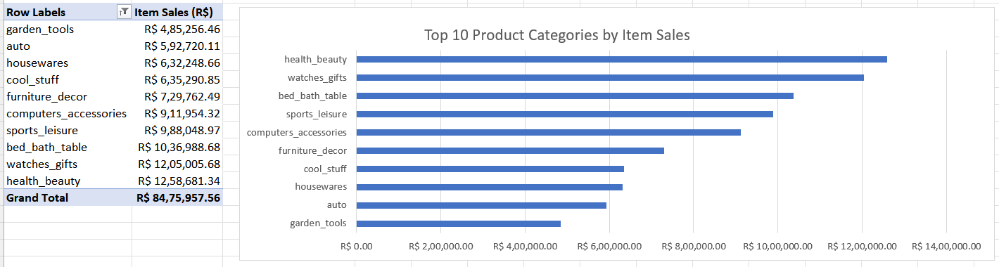
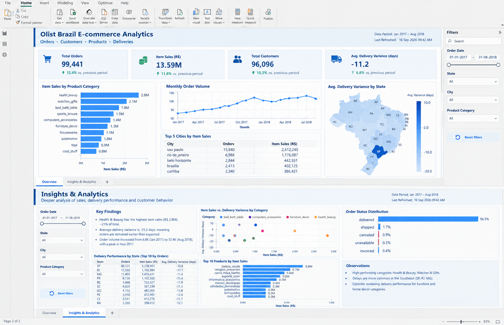

# 📊 E-commerce Analytics — Olist Brazil

### *Tracing item sales, order volume, customer-state performance, and delivery variance across Excel, Power BI, and Streamlit*

---


## 📌 Project Overview

This repository contains three versions of an analysis of the **Brazilian E-Commerce Public Dataset by Olist**:

- **V1 — Excel Analytics:** Order-level and item-level analysis using an Excel workbook with prepared tables and pivot summaries.

- **V2 — Power BI Analytics:** An interactive dashboard documented through project notes and dashboard screenshots.

- **V3 — AI-Assisted Analytics:** A Streamlit application that reads a checked-in aggregated metrics CSV, calculates supported summaries in Python, and uses the Groq API to explain those metrics in natural language.

The project focuses on item sales, order volume, product categories, customer states, and the difference between actual and estimated delivery dates.


---

## 🧩 Key Objectives

| Primary questions | Analysis covered |
| --- | --- |
| Which product categories account for the largest item sales? | Category-level item sales and top-category rankings |
| How does delivery timing vary across Brazil? | Average delivery variance by customer state |
| How does order volume change over time? | Monthly order volume and month-over-month growth in the Excel analysis |
| How can the verified metrics be explored conversationally? | Streamlit tables, charts, metric definitions, and an optional Groq-powered question-answering section |

> **Metric scope:** Item sales are calculated from order-item `price` values. They exclude freight and should not be interpreted as profit.

---

## 🏗️ Analysis Flow

```
Olist Brazilian E-Commerce Dataset
                │
                ▼
      Excel preparation and analysis
                │
        ┌───────┴────────┐
        ▼                ▼
   V1 Excel        V2 Power BI
        │                │
        └───────┬────────┘
                ▼
   Aggregated metrics_summary.csv
                │
                ▼
        V3 Streamlit application
                │
                ▼
 Optional Groq explanation of the
 supported aggregated metrics
```

The repository currently includes the analysis outputs and the V3 application inputs. The raw Olist CSV files used by `build_metrics.py` and the editable Power BI `.pbix` file are not included in the checked-in repository.

---

## 📁 Repository Structure

```
ecommerce-analytics/
├── v1-excel/
│   ├── findings.md                    # Written findings and limitations
│   ├── screenshot-v1.png             # Excel analysis preview
│   └── track-a-v1-analysis.xlsx      # Excel workbook
├── v2-powerbi/
│   ├── notes.md                       # Dashboard scope and version notes
│   ├── screenshot-v2.png             # Power BI overview preview
│   └── track-a-v2-dashboard.png      # Power BI dashboard image
├── v3-ai-app/
│   ├── .streamlit/
│   │   └── secrets.toml.example       # Example Groq secret configuration
│   ├── analytics.py                   # Validated metric functions
│   ├── app.py                         # Streamlit application
│   ├── build_metrics.py               # Builds the aggregated metrics CSV
│   ├── metrics_summary.csv            # Checked-in aggregated metrics
│   └── requirements.txt               # Python dependencies
├── .gitignore
└── README.md
```

The repository does not contain `v1-excel/raw-data/`, although `v3-ai-app/build_metrics.py` expects source CSVs in that path when rebuilding `metrics_summary.csv`.

---

## 🗂️ Dataset

The analysis is based on the **Brazilian E-Commerce Public Dataset by Olist**.

- Dataset source: [Olist Brazilian E-Commerce Public Dataset](https://www.kaggle.com/datasets/olistbr/brazilian-ecommerce)

- Geography: Brazil

- Analysis entities represented in the project: orders, order items, products, customers, product-category translations, and delivery dates

Refer to the original dataset page for the dataset license and terms of use.

---

## 📈 V1 — Excel Analytics

The Excel workbook contains the following sheets:

| Sheet | Contents |
| --- | --- |
| `OrderAnalysis` | Order-level fields including order status, purchase and delivery timestamps, customer state, delivery variance, and order month |
| `SalesItems` | Order-item fields including product, seller, price, freight value, and translated category |
| `Pivot_Revenue` | Top product categories by item sales |
| `Pivot_MoM` | Monthly order volume and month-over-month growth formulas |
| `Pivot_Delivery` | Average delivery variance by Brazilian state |
| `Sheet1` | Empty worksheet in the checked-in workbook |

### V1 Definitions

- **Item sales:** sum of order-item `price`; freight is excluded.

- **Delivery variance:** actual customer delivery date minus estimated delivery date.

- **Negative delivery variance:** delivered earlier than estimated.

- **Positive delivery variance:** delivered later than estimated.

- Orders without usable delivery dates are excluded from delivery-variance averages but remain part of the overall order data.

### V1 Findings

The findings document reports the following results:

- The top 10 product categories generated **R$8,475,957.56**, approximately **62.4%** of total item sales of **R$13,591,643.70**.

- **Health & Beauty** was the largest individual category at **R$1,258,681.34**.

- **Watches & Gifts** followed at **R$1,205,005.68**, and **Bed & Bath Table** at **R$1,036,988.68**.

- Average delivery variance was approximately **−11.2 days** among orders with valid delivery and estimated delivery dates.

- **November 2017** had the highest monthly order volume in the main analysis period, with **7,544 orders** and **62.9%** month-over-month growth from October.

- **1,627 order-item rows** had no translated product category and represented **R$185,049.76** in item sales. These rows were retained as a data-quality limitation rather than silently removed.

The detailed source is [`v1-excel/findings.md`](v1-excel/findings.md).

### V1 Preview


---

## 📊 V2 — Power BI Analytics

The V2 notes describe a Power BI dashboard built around connected Orders, OrderItems, Products, Customers, CategoryTranslation, and Date data.

### Documented dashboard areas

- KPI cards for total orders, item sales, customers, and average delivery variance

- Item sales by product category

- Monthly order-volume trend

- Average delivery variance by Brazilian state

- Top-city item sales and order-volume analysis

- Date, state, product-category, and customer-city filters

- Category-to-product and state-to-city drill-down

- Cross-filtering across visuals

- An Insights & Analytics page

- A Data Dictionary page

The repository includes dashboard screenshots and notes. It does **not** include the editable Power BI `.pbix` file or a live Power BI link.

### V2 Preview



The dashboard images included in the repository show an overview with KPI cards, category sales, monthly order volume, top cities, state-level delivery variance, filters, and an Insights & Analytics area.

The detailed source is [`v2-powerbi/notes.md`](v2-powerbi/notes.md).

---

## 🤖 V3 — AI-Assisted Streamlit Analytics

The V3 application uses a small, checked-in `metrics_summary.csv` file rather than loading the raw order and customer CSV files at runtime.

### V3 Preview

<p align="center">
  
</p>

<p align="center">
  
</p>

### Application behavior

1. `app.py` loads and validates the required columns in `metrics_summary.csv`.

1. The metrics are separated into `category`, `state`, and `overall` aggregation levels.

1. Streamlit displays performance KPIs, category tables and charts, state tables and charts, initial observations, and metric limitations.

1. Users can optionally enter a Groq API key through Streamlit secrets or the session interface.

1. The application sends the question and aggregated metrics CSV to Groq through an OpenAI-compatible client endpoint.

1. The AI instructions require answers to use only the supplied aggregated metrics and to distinguish unavailable metrics from verified results.

The application does not send the raw order or customer CSV files to the API.


### V3 Metrics

| Field | Meaning |
| --- | --- |
| `level` | `category`, `state`, or `overall` |
| `dimension` | Product category, Brazilian state code, or `All orders` |
| `item_sales_brl` | Sum of order-item prices in Brazilian reais; freight excluded |
| `order_count` | Distinct order count for the represented aggregation |
| `avg_delivery_variance_days` | Actual delivery date minus estimated delivery date, in days |

### Current overall row

The checked-in `metrics_summary.csv` reports:

| Metric | Value |
| --- | --- |
| Item sales | R$13,591,643.70 |
| Distinct orders | 99,441 |
| Average delivery variance | −11.18 days |

These values describe the checked-in aggregated metrics file. They should not be compared with another version unless the filters, source data, aggregation logic, and metric definitions are aligned.

### V3 Files

| File | Responsibility |
| --- | --- |
| `app.py` | Streamlit UI, CSV loading, tables, charts, metric explanations, and Groq question answering |
| `analytics.py` | CSV validation, top-category ranking, overall metrics, and sales-difference calculation |
| `build_metrics.py` | Reads raw Olist CSVs, joins products and translations, calculates category/state/overall metrics, and writes the summary CSV |
| `metrics_summary.csv` | Aggregated data consumed by the app |
| `requirements.txt` | `streamlit`, `pandas`, and `openai` dependencies |
| `.streamlit/secrets.toml.example` | Example configuration for `GROQ_API_KEY` |

---

## 🚀 Run the Streamlit Application

### Prerequisites

- Python installed locally

- The repository cloned

- Dependencies from `v3-ai-app/requirements.txt`

- A Groq API key only if using the question-answering feature

### 1. Clone the repository

```bash
git clone https://github.com/VishnuKokkula/ecommerce-analytics.git
cd ecommerce-analytics/v3-ai-app
```

### 2. Create and activate a virtual environment

```bash
python -m venv .venv
```

**Windows PowerShell**

```
.venv\Scripts\Activate.ps1
```

**macOS / Linux**

```bash
source .venv/bin/activate
```

### 3. Install dependencies

```bash
python -m pip install --upgrade pip
python -m pip install -r requirements.txt
```

### 4. Configure the optional Groq key

Copy the example file to a local secrets file:

```bash
cp .streamlit/secrets.toml.example .streamlit/secrets.toml
```

Set the key in `.streamlit/secrets.toml`:

```
GROQ_API_KEY = "YOUR_GROQ_API_KEY"
```

The application also allows a key to be entered for the current Streamlit session. Do not commit the real `secrets.toml` file.

### 5. Start Streamlit

```bash
python -m streamlit run app.py
```

Open the local URL displayed by Streamlit.

> The application can use the checked-in `metrics_summary.csv` without the raw dataset. Rebuilding the CSV requires the raw Olist files in the paths expected by `build_metrics.py`; those files are not included in this repository.

---

## 🛠️ Tech Stack

| Component | Technology |
| --- | --- |
| Spreadsheet analysis | Microsoft Excel / Power Query workbook artifacts |
| Dashboard analysis | Microsoft Power BI |
| Application UI | Streamlit |
| Data processing | Python and pandas |
| AI interface | Groq API through the OpenAI-compatible Python client |
| Stored V3 input | Aggregated CSV |

---

## ⚠️ Limitations and Interpretation Notes

- Item sales are not profit and exclude freight.

- Category and state rows are separate views of the same business data; they must not be added together.

- Category and state order counts are not additive national order totals.

- A national delivery average should not be calculated as a simple average of state averages.

- Orders without usable delivery dates cannot contribute to delivery-variance averages.

- The `Unknown / untranslated` category is retained in the V3 metrics rather than silently discarded.

- The analysis is descriptive and does not establish causation, profitability, customer satisfaction, or logistics quality by itself.

- The V3 AI assistant is limited to the aggregated data and definitions supplied in the application context.

- The raw source data and editable Power BI file are not checked into the repository, so the full preparation and dashboard-editing workflow cannot be reproduced from the repository alone.


---

## 👤 Author

**VishnuTeja Kokkula**

- GitHub: [VishnuKokkula](https://github.com/VishnuKokkula)

- Repository: [ecommerce-analytics](https://github.com/VishnuKokkula/ecommerce-analytics)

---

## 📄 Project Notes

The detailed findings and version notes remain available in:

- [`v1-excel/findings.md`](v1-excel/findings.md)

- [`v2-powerbi/notes.md`](v2-powerbi/notes.md)
